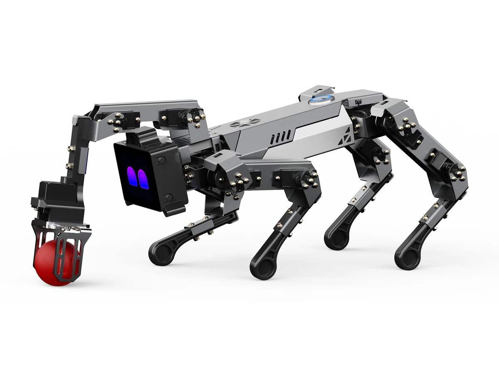
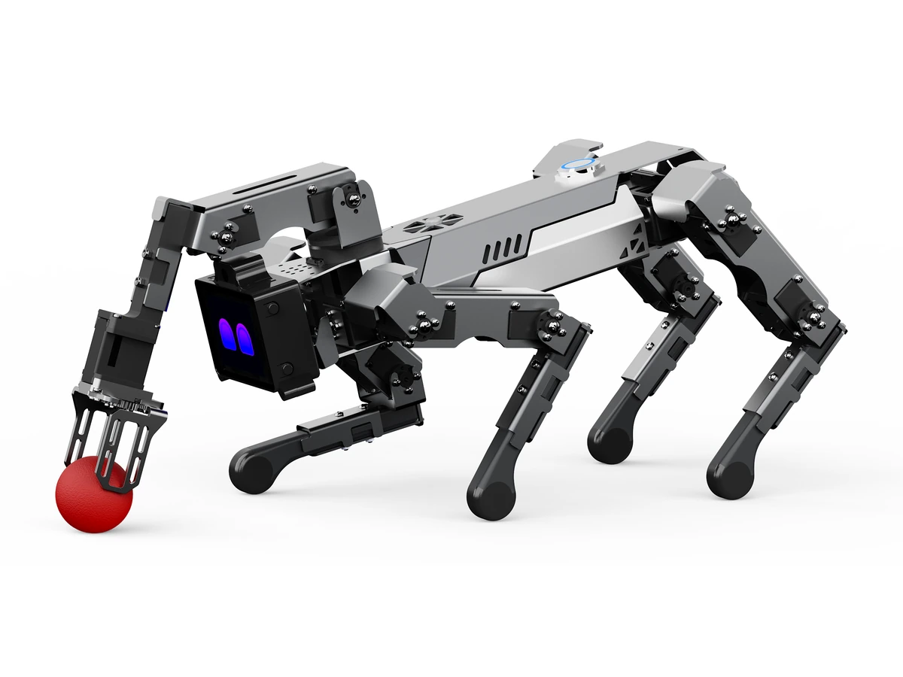
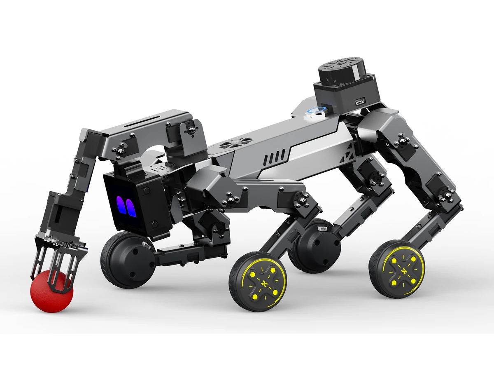
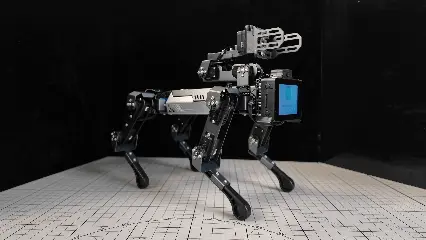
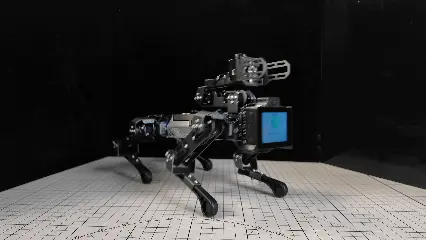
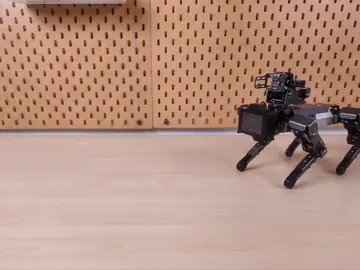
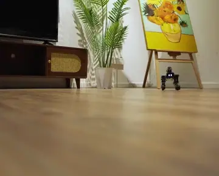

<div align="center">

# XGO Dog Firmware

**English** · [简体中文](README_CN.md)

Shared ESP32 motion-control firmware by **Luwu Dynamics** for **XGO-lite3**, **XGO-mini2S**, and **XGO-mini2SW**.

[Communication API](docs/api_en.md) · [中文 API](docs/api.md)

</div>

| XGO-lite3 | XGO-mini2S | XGO-mini2SW |
| :---: | :---: | :---: |
| <a href="https://www.xgorobot.com/lite3.html"></a> | <a href="https://www.xgorobot.com/mini2S.html"></a> | <a href="https://www.xgorobot.com/miniw.html"></a> |
| [Product page](https://www.xgorobot.com/lite3.html) | [Product page](https://www.xgorobot.com/mini2S.html) | [Product page](https://www.xgorobot.com/miniw.html) |

The firmware detects the servo family, IMU, and optional wheel motors at startup and selects the corresponding hardware and motion parameters. The ESP32 handles motion, servo and wheel communication, and UART/BLE control. Higher-level applications on the Raspberry Pi are maintained separately.

## Build and flash

Use PlatformIO Core or the PlatformIO extension for VS Code. The [build configuration](platformio.ini) targets a 4 MB ESP32 at 240 MHz using Arduino and FreeRTOS. It pins Espressif32 to `7.0.1` and Adafruit NeoPixel to `1.12.0`. The `esp32dev` environment builds the same firmware image for all three models.

```sh
python -m pip install platformio==6.1.18
pio run -e esp32dev
```

The application image is generated at `.pio/build/esp32dev/firmware.bin`.

Connect the ESP32 programming port, list available ports, and replace `COM3` with the actual port.

```sh
pio device list
pio run -e esp32dev -t upload --upload-port COM3
```

The robot restarts after flashing and runs its startup standing and arm-folding sequence. A normal upload preserves servo zero positions and the stored BLE name. The [flash partition table](xgo_two_ota.csv) defines the layout. Erasing the entire flash also erases calibration data.

## Source layout

| Directory | Responsibility |
| --- | --- |
| [`src/robot`](src/robot) | Model profiles, shared state, and numeric conversions |
| [`src/motion`](src/motion) and [`src/action`](src/action) | Motion control, kinematics, gaits, and built-in actions |
| [`src/motor`](src/motor) and [`src/sensor`](src/sensor) | Servo and wheel buses, IMU acquisition, and attitude estimation |
| [`src/protocol`](src/protocol) and [`src/board`](src/board) | Host protocols, UART/BLE, board I/O, and calibration storage |

The [communication API](docs/api_en.md) documents both protocol formats, commands, and telemetry. See [AGENTS.md](AGENTS.md) for repository development conventions.

## XGO robots in motion

| Lite3 · Squat | Lite3 · Dance |
| :---: | :---: |
|  |  |

| Mini2S · Dynamic gait | Mini2SW · Wheel-legged mobility |
| :---: | :---: |
|  |  |

*Product images and animations from the official product pages. [Lite3](https://www.xgorobot.com/lite3.html) · [Mini2S](https://www.xgorobot.com/mini2S.html) · [Mini2SW](https://www.xgorobot.com/miniw.html)*

## License

The XGO Dog firmware, project configuration, and documentation are licensed under the Apache License 2.0. Product photos and animations in `media/` are provided for illustration. Third-party dependencies are governed by their respective licenses. [License](LICENSE) · [Attribution](NOTICE)
