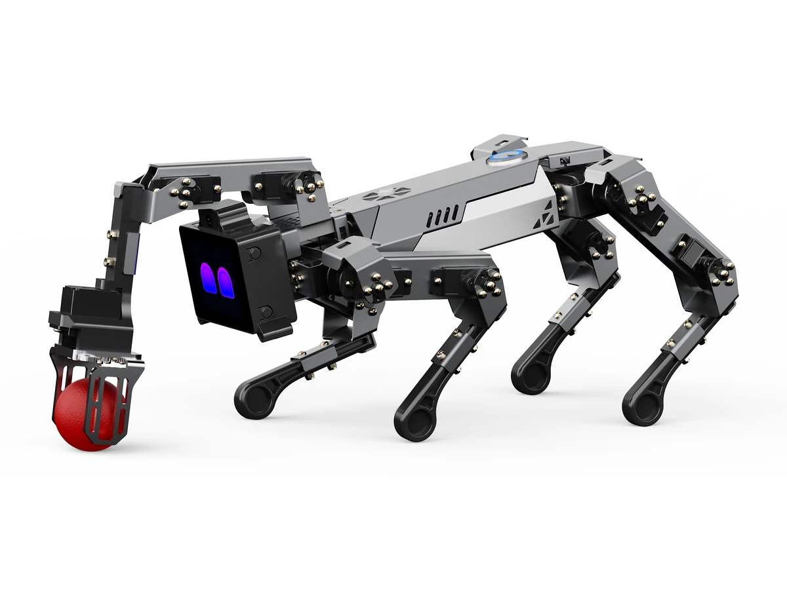
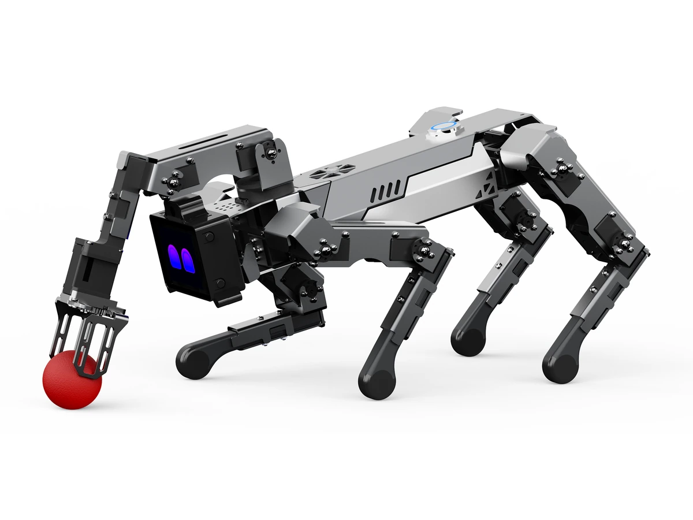
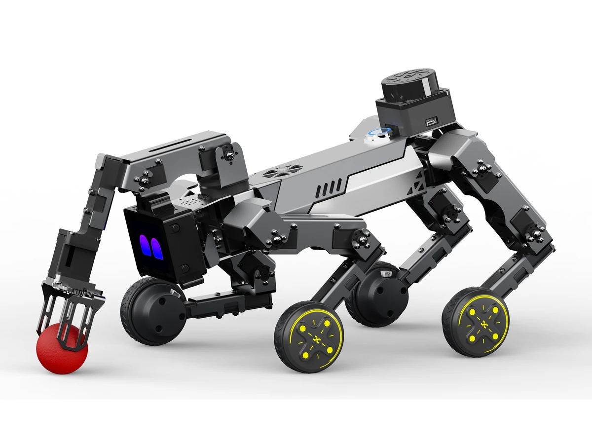
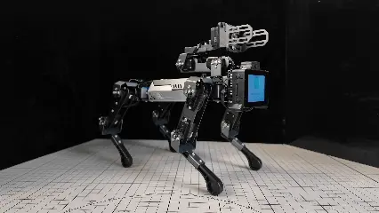
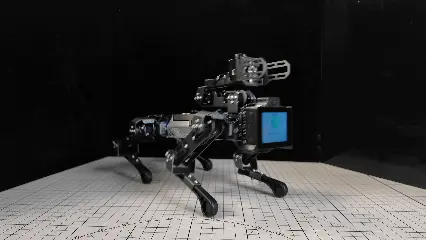
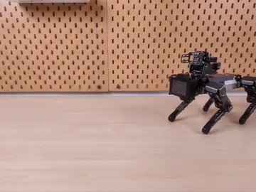
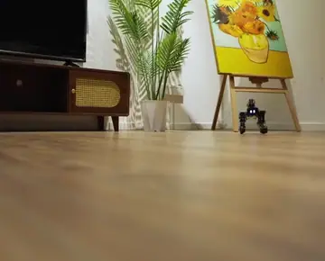

<div align="center">

# XGO Dog 通用固件

[English](README.md) · **简体中文**

**陆吾智能（Luwu Dynamics）**为 **XGO-lite3、XGO-mini2S、XGO-mini2SW** 机器人开发的 ESP32 通用运动控制固件。

[通信 API](docs/api.md) · [English API](docs/api_en.md)

</div>

| XGO-lite3 | XGO-mini2S | XGO-mini2SW |
| :---: | :---: | :---: |
| <a href="https://www.xgorobot.com/lite3.html"></a> | <a href="https://www.xgorobot.com/mini2S.html"></a> | <a href="https://www.xgorobot.com/miniw.html"></a> |
| [官网产品页](https://www.xgorobot.com/lite3.html) | [官网产品页](https://www.xgorobot.com/mini2S.html) | [官网产品页](https://www.xgorobot.com/miniw.html) |

固件在启动时识别舵机、IMU 和可选轮电机，加载相应的硬件及运动参数。ESP32 负责运动控制、舵机和轮电机通信，以及 UART/BLE 控制。树莓派上的上层应用独立维护。

## 编译与烧录

使用 PlatformIO Core 或 VS Code 的 PlatformIO 扩展。[构建配置](platformio.ini) 使用 240 MHz、4 MB Flash 的 ESP32，基于 Arduino 和 FreeRTOS，固定 Espressif32 平台版本为 `7.0.1`、Adafruit NeoPixel 为 `1.12.0`。三款机器人使用 `esp32dev` 构建的同一份固件。

```sh
python -m pip install platformio==6.1.18
pio run -e esp32dev
```

应用镜像输出到 `.pio/build/esp32dev/firmware.bin`。

连接 ESP32 烧录口，查看可用串口，并将 `COM3` 替换为设备实际使用的端口。

```sh
pio device list
pio run -e esp32dev -t upload --upload-port COM3
```

烧录后机器人会自动重启，并执行上电站立和机械臂折叠流程。正常上传会保留舵机零点与已保存的 BLE 名称。[Flash 分区表](xgo_two_ota.csv) 定义存储布局，全片擦除会清除已有标定数据。

## 项目结构

| 目录 | 职责 |
| --- | --- |
| [`src/robot`](src/robot) | 机型参数、共享状态与数值转换 |
| [`src/motion`](src/motion) 和 [`src/action`](src/action) | 运动控制、运动学、步态与内建动作 |
| [`src/motor`](src/motor) 和 [`src/sensor`](src/sensor) | 舵机与轮电机总线、IMU 采集与姿态估计 |
| [`src/protocol`](src/protocol) 和 [`src/board`](src/board) | 主机协议、UART/BLE、板级 I/O 与标定存储 |

两套协议的报文格式、控制指令和状态反馈见[通信 API](docs/api.md)。开发约定见 [AGENTS.md](AGENTS.md)。

## XGO 动作展示

| Lite3 · 蹲起 | Lite3 · 跳舞 |
| :---: | :---: |
|  |  |

| Mini2S · 动态步态 | Mini2SW · 轮足移动 |
| :---: | :---: |
|  |  |

*图片和动图取自陆吾智能官网产品页。 [Lite3](https://www.xgorobot.com/lite3.html) · [Mini2S](https://www.xgorobot.com/mini2S.html) · [Mini2SW](https://www.xgorobot.com/miniw.html)*

## 许可证

XGO Dog 固件、工程配置和文档采用 Apache License 2.0。`media/` 中的产品图片和动图仅供展示。第三方依赖适用各自的许可证。 [许可证正文](LICENSE) · [署名声明](NOTICE)
